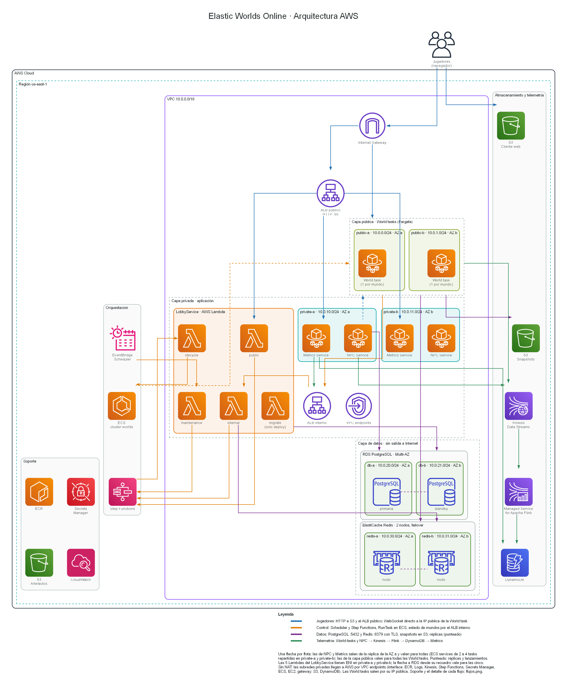
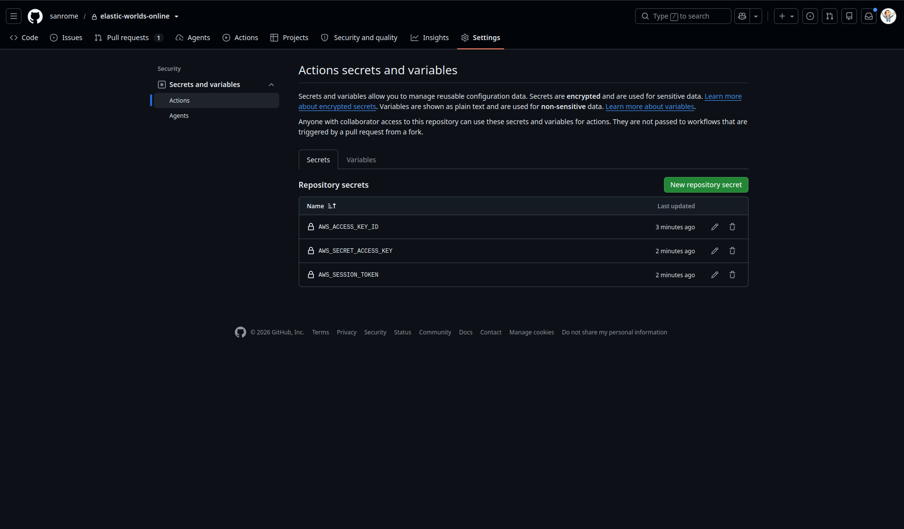
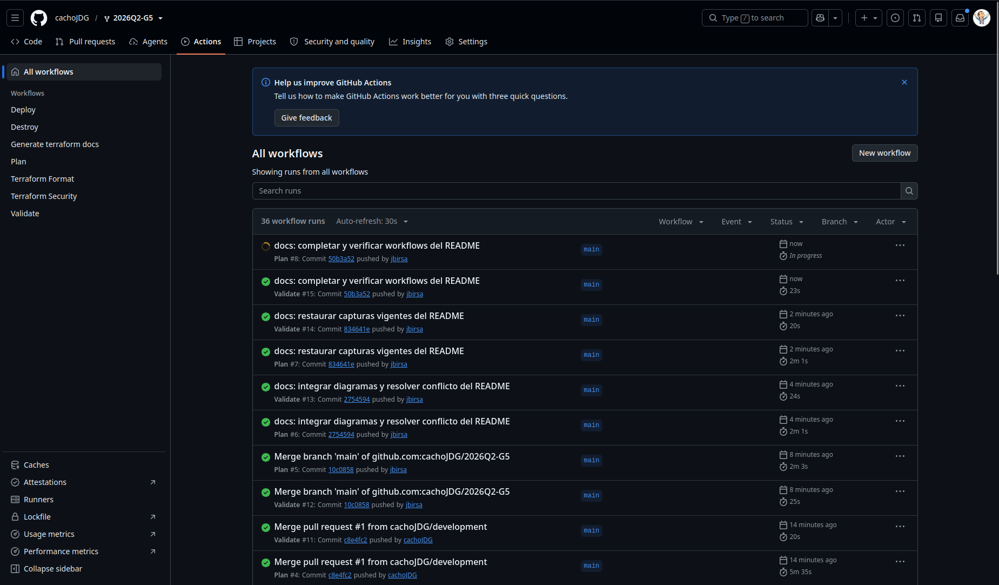
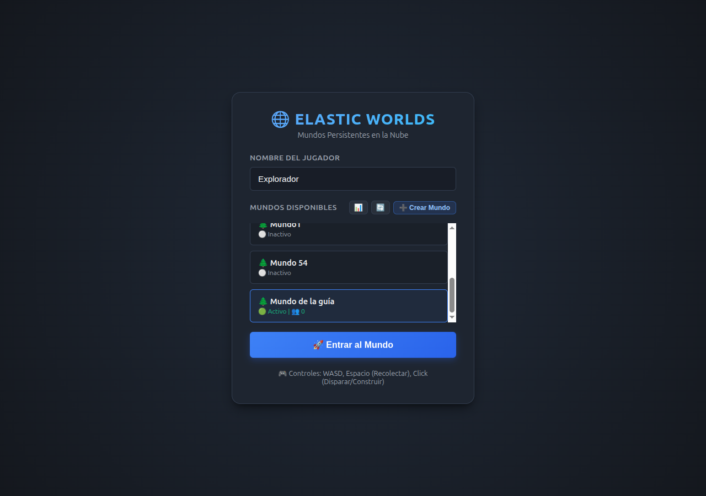
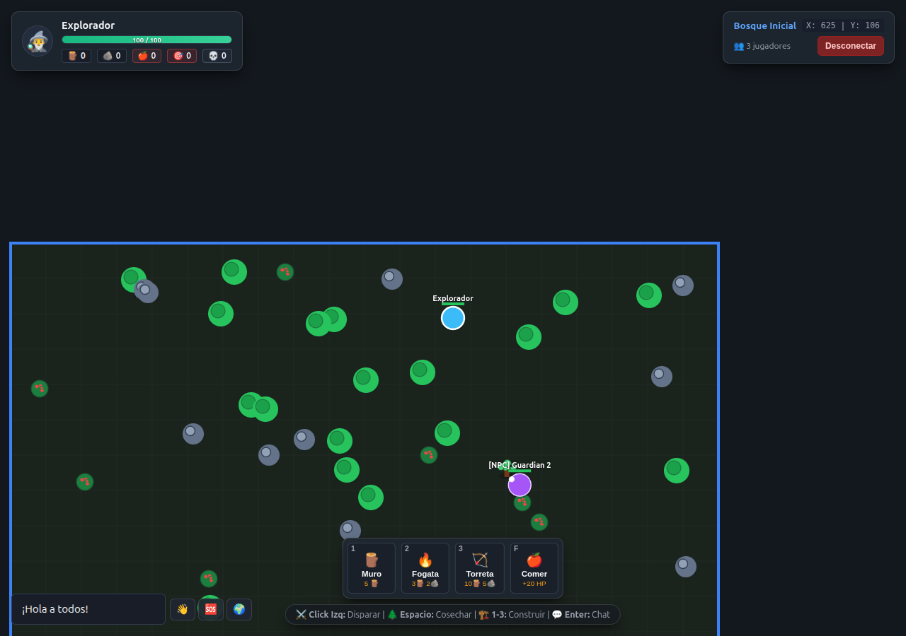
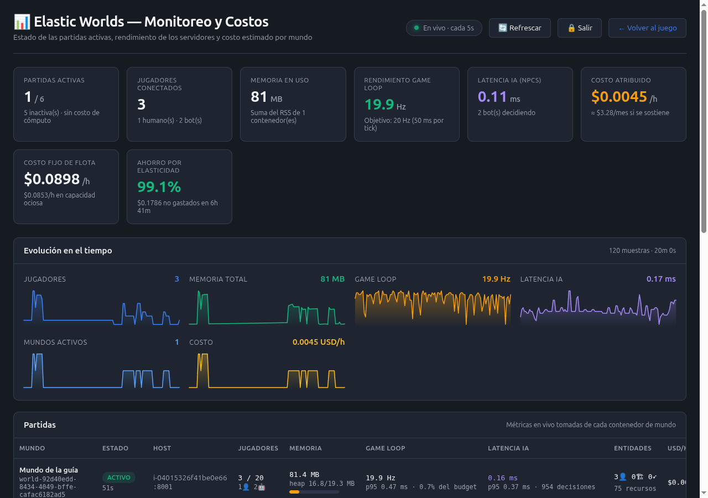
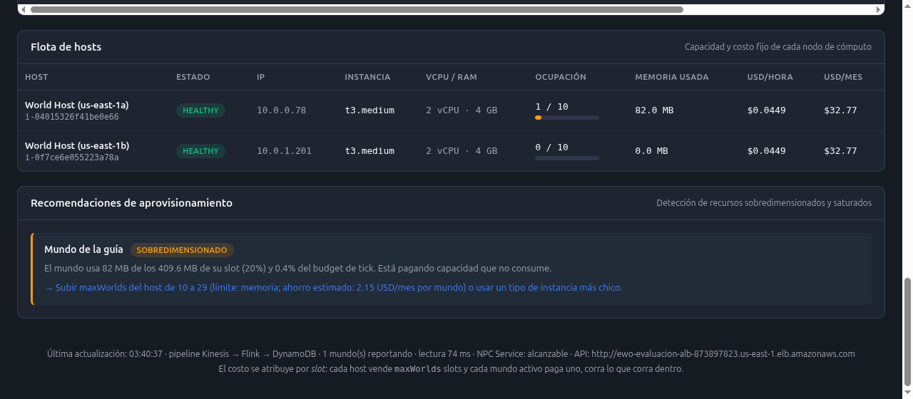

# Elastic Worlds Online — Infraestructura como Código

Juego multijugador con mundos persistentes y panel de monitoreo. La infraestructura
está en [`infra/`](infra/), con cinco módulos propios y módulos externos versionados.

**[Arquitectura](#arquitectura)** ·
**[Despliegue](#desplegar-en-aws)** ·
**[Guía de uso](#cómo-jugar-y-usar-el-monitoreo)** ·
**[Módulos Terraform](#módulos-terraform)** ·
**[Funciones y metaargumentos](#funciones-y-metaargumentos-de-terraform)**

La [demo del equipo](http://ewo-evaluacion-client-891200271122.s3-website-us-east-1.amazonaws.com/)
requiere el Learner Lab activo.

## Arquitectura



Los diagramas de [arquitectura AWS](.docs/arquitectura/arquitectura-aws.png) y
[flujos](.docs/arquitectura/flujos.png) describen los recursos y recorridos del sistema.
Se generan con [`generar_diagramas.py`](.docs/arquitectura/generar_diagramas.py);
requiere Graphviz y `pip install diagrams`.

## Desplegar en AWS

El despliegue se ejecuta desde **GitHub Actions**, que prepara el backend,
construye los artefactos y aplica Terraform.

### 1. Obtener las credenciales del Lab

Iniciar el **Learner Lab** y abrir **AWS Details → AWS CLI → Show**.
Copiar `aws_access_key_id`, `aws_secret_access_key` y `aws_session_token`
de la sesión activa.

### 2. Configurar los secrets en GitHub

En **Settings → Secrets and variables → Actions → New repository secret**,
cargar los siguientes valores, sin comillas ni la línea `export`:

| Secret | Valor del Lab |
| --- | --- |
| `AWS_ACCESS_KEY_ID` | `aws_access_key_id` |
| `AWS_SECRET_ACCESS_KEY` | `aws_secret_access_key` |
| `AWS_SESSION_TOKEN` | `aws_session_token` |



Cuando expire la sesión, renovar los tres secrets. Las contraseñas de la base
de datos y del dashboard se generan en Secrets Manager.

Los workflows usan `us-east-1` y obtienen el ID de cuenta de las credenciales.
El bucket de estado `elastic-worlds-tfstate-<account-id>` se prepara automáticamente.

### 3. Elegir el workflow

Abrir la pestaña **Actions**; en un fork, habilitarla si GitHub lo solicita.



| Workflow | Cómo se inicia | Qué hace |
| --- | --- | --- |
| [Validate](.github/workflows/validate.yml) | Push, PR o ejecución manual | Verifica formato y configuración de Terraform |
| [Plan](.github/workflows/plan.yml) | Push a `main` o ejecución manual con `confirm: plan` | Prepara el backend y calcula los cambios sin aplicarlos |
| [Deploy](.github/workflows/deploy.yml) | Ejecución manual con `confirm: deploy` | Prepara el backend, valida, planifica y aplica |
| [Destroy](.github/workflows/destroy.yml) | Ejecución manual con `confirm: destroy` | Destruye el entorno y conserva el backend |
| [Terraform Format](.github/workflows/terraform-format.yml) | PR | Verifica el formato y publica el resultado en el PR |
| [Terraform Security](.github/workflows/tfsec.yaml) | PR | Analiza la configuración con Trivy y publica un reporte SARIF y un resumen |
| [Generate terraform docs](.github/workflows/terraform-docs.yml) | PR | Genera los README de los módulos y pushea los cambios a la rama del PR |

### 4. Ejecutar Deploy

1. Abrir **Actions → Deploy → Run workflow**.
2. Elegir **`main`** y escribir **`deploy`** en **confirm**.
3. Presionar **Run workflow** y esperar a que termine.

Terraform construye las imágenes, los ZIP de Lambda y el JAR de Flink desde
el repositorio. Los despliegues posteriores reutilizan el mismo estado.

### 5. Abrir la aplicación

En el **Summary** del run, consultar **Deployment outputs**:

- `client_website_url`: juego web.
- `client_website_url` + `/dashboard.html`: panel de monitoreo.
- `alb_url`: API pública.

Para ingresar al dashboard, usar **`admin`** y consultar la contraseña en
**AWS → Secrets Manager**, mediante el ARN de `metrics_password_secret_arn`.
Seleccionar **Secret value → Retrieve secret value** y copiarla al formulario.

### 6. Retirar el entorno

Abrir **Actions → Destroy → Run workflow**, elegir **`main`** y escribir **`destroy`**.
El backend y los buckets de datos/artefactos se conservan por defecto.

## Cómo jugar y usar el monitoreo

### 1. Abrir el juego

Abrir `client_website_url`, escribir un nombre en **Nombre del Jugador** y
consultar **Mundos Disponibles**. **🔄** actualiza la lista y **📊** abre el monitoreo.


Usar la URL HTTP del website de S3 que devuelve Terraform para evitar bloqueos
por contenido mixto con la API HTTP.

### 2. Crear un mundo

Presionar **➕ Crear Mundo** y completar el formulario, o elegir un mundo existente.

| Campo | Qué ingresar |
| --- | --- |
| Nombre del Mundo | Nombre para identificarlo |
| Semilla | Opcional; permite repetir la generación del mapa |
| Bioma | Bosque Templado, Desierto Árido o Tundra Helada |
| Bots Autónomos Iniciales | Cantidad de NPC |


Presionar **Crear y Aprovisionar** y esperar a que el mundo aparezca en la lista.
Si figura **Iniciando**, refrescar la lista hasta que esté disponible.

### 3. Entrar al mundo

Seleccionar un mundo y presionar **🚀 Entrar al Mundo**.
Los mundos **Inactivos** se inician bajo demanda; la primera conexión puede tardar.



### 4. Jugar y salir de la partida

La interfaz muestra vida, inventario, coordenadas y jugadores conectados.



| Control | Acción |
| --- | --- |
| `W`, `A`, `S`, `D` | Moverse |
| `Espacio` | Recolectar recursos cercanos |
| Click izquierdo | Disparar o construir con la selección activa |
| `1`, `2`, `3` | Seleccionar muro, fogata o torreta |
| `F` | Consumir comida para recuperar vida |
| `Enter` | Escribir/enviar un mensaje de chat |
| **Desconectar** | Volver al lobby |

Para jugar con otra persona, abrir el cliente con otro nombre y entrar al mismo
mundo. El chat también comunica mundos distintos mediante Redis Pub/Sub.

Los mundos guardan snapshots en S3 y pueden detenerse por inactividad.
Volver a entrar con el mismo nombre de jugador permite recuperar los datos guardados.

### 5. Acceder al panel de monitoreo

Presionar **📊** en el lobby. El usuario predeterminado es **`admin`**.
Para obtener la contraseña:

- **Desde la consola AWS:** con el Lab iniciado, abrir **Secrets Manager** en
  **`us-east-1`**, seleccionar **`<project_name>-metrics-password`** y presionar
  **Secret value → Retrieve secret value**.
- **Desde la terminal:** con el Lab iniciado y las credenciales en `~/.aws/credentials`, ejecutar:

  ```bash
  aws secretsmanager get-secret-value --secret-id elastic-worlds-metrics-password --query SecretString --output text --region us-east-1
  ```

Copiar el valor al campo **Contraseña** e ingresar. **Salir** cierra la sesión
y **Volver al juego** regresa al cliente.


### 6. Leer las métricas

El panel se actualiza cada cinco segundos. **Refrescar** solicita una actualización manual.



| Sección | Qué muestra |
| --- | --- |
| Partidas activas | Mundos activos respecto del total |
| Jugadores conectados | Humanos y bots |
| Memoria y game loop | Memoria y frecuencia de la simulación |
| Latencia IA | Tiempo de decisión de los NPC |
| Evolución en el tiempo | Historial de métricas y costos |
| Partidas | Estado, host y mediciones de cada mundo |

La telemetría pasa por Kinesis, Flink y DynamoDB; los cambios aparecen en las
siguientes muestras del pipeline.

### 7. Consultar hosts y costos

**Flota de hosts** muestra capacidad, ocupación y costo estimado.
Las recomendaciones comparan el uso con los recursos asignados.



Los importes son estimaciones de la aplicación, no la factura total de AWS.
Los servicios compartidos pueden generar cargos aunque los mundos estén inactivos.

## Módulos Terraform

El módulo raíz conecta las entradas y salidas de cinco módulos propios:

| Módulo | Instancia en el root | Responsabilidad |
| --- | --- | --- |
| [`network`](infra/modules/network/) | `module.network` | Red compartida |
| [`data`](infra/modules/data/) | `module.data` | Persistencia y caché |
| [`container-workload`](infra/modules/container-workload/) | `module.npc`, `module.metrics`, `module.world_tasks` | Contenedores en Fargate |
| [`telemetry`](infra/modules/telemetry/) | `module.telemetry` | Ingesta y procesamiento de métricas |
| [`lobby`](infra/modules/lobby/) | `module.lobby` | API y ciclo de vida de los mundos |

### `network`

Crea VPC, subredes por capa en dos AZ, tablas de rutas, NACLs y endpoints.
Entrega la red a los demás módulos; los mundos usan subredes públicas y los
servicios internos, privadas.

- **Entradas:** `name`, `region`, `azs`, `vpc_cidr`, `subnet_cidrs`, `interface_endpoints`.
- **Salidas:** VPC, subredes, tablas de rutas, `s3_prefix_list_id`, `endpoint_security_group_ids`.
- **Externos:** `terraform-aws-modules/vpc/aws` y `vpc-endpoints`, versión **5.21.0**.

### `data`

Crea RDS y ElastiCache sobre las subredes y los SG recibidos.
Lobby y NPC consumen la base de datos; Lobby también usa Redis.

- **Entradas:** subredes, SG, `username`, `manage_master_user_password`, `multi_az`.
- **Salidas:** `address`, `port`, `db_name`, `resource_id`, `master_user_secret_arn`, `redis_url`.
- **Externos:** `terraform-aws-modules/rds/aws` **6.13.1** y `terraform-aws-modules/elasticache/aws` **1.11.2**.

### `container-workload`

Define cluster, logs y task definition, con publicación de imágenes, servicio y
autoscaling opcionales. NPC y Metrics mantienen servicios; Lobby inicia y detiene
las tasks de mundos. Usa roles IAM existentes.

- **Entradas:** CPU, memoria, puerto, entorno, roles, imagen y configuración del servicio.
- **Salidas:** `cluster_name`, `task_definition_arn`, `service_name`, `repository_url`, `log_group_name`, `autoscaling`.

### `telemetry`

Crea el stream Kinesis, la tabla DynamoDB y la aplicación Flink con sus logs.
Recibe el bucket y el JAR desde el root; Metrics consume los resultados.

- **Entradas:** `name`, `region`, `account_id`, `artifacts_bucket`, `flink_jar_path`, `flink_source_hash`, `service_role_arn`, `start_application`.
- **Salidas:** `stream_name`, `stream_arn`, `table_name`, `application_name`.
- **Lab:** `create_stream_with_script` permite crear el stream cuando la API del provider está restringida.

### `lobby`

Agrupa las funciones `public`, `internal`, `lifecycle`, `maintenance` y `migrate`,
los workflows `start`/`stop`, target groups, permisos y mantenimiento programado.
Ejecuta las migraciones antes de habilitar las funciones dependientes.

- **Entradas:** ZIP, workflows, migraciones, red, roles, entorno y `database_resource_id`.
- **Salidas:** `target_group_arns`, `workflows`, `function_names`, `maintenance_alias_arn`, `maintenance_schedule`.
- **Integración:** recibe los contratos de datos, telemetría, snapshots y launcher; el root conecta las APIs con los balanceadores.

### Composición del módulo raíz

[`infra/`](infra/) conecta los módulos y administra SG, listeners, cliente web,
snapshots, secretos y bootstrap de artefactos. Las versiones de los módulos
externos se fijan en los bloques `module`; las de providers, en
[`.terraform.lock.hcl`](infra/.terraform.lock.hcl).

## Funciones y metaargumentos de Terraform

### Funciones

| Función | Uso | Referencia |
| --- | --- | --- |
| `cidrsubnet()` | Derivar los CIDR de cada capa | [main.tf](infra/main.tf) |
| `slice()` | Elegir las dos primeras AZ disponibles | [main.tf](infra/main.tf) |
| `templatefile()` | Completar las definiciones de Step Functions | [lobby/main.tf](infra/modules/lobby/main.tf) |
| `join()` | Pasar los IDs de subredes al launcher | [worlds-fargate.tf](infra/worlds-fargate.tf) |
| `jsonencode()` | Generar `runtime-config.js` | [storage.tf](infra/storage.tf) |
| `merge()` | Combinar la configuración del Lobby y del launcher | [lobby-serverless.tf](infra/lobby-serverless.tf) |
| `toset()` | Iterar funciones y workflows con nombres estables | [lobby/main.tf](infra/modules/lobby/main.tf) |
| `filebase64sha256()` | Detectar cambios en los ZIP de Lambda | [lobby/main.tf](infra/modules/lobby/main.tf) |

### Metaargumentos

| Metaargumento | Uso | Referencia |
| --- | --- | --- |
| `for_each` | Crear funciones y target groups con claves estables | [lobby/main.tf](infra/modules/lobby/main.tf) |
| `count` | Activar el bootstrap según `bootstrap_from_source` | [bootstrap.tf](infra/bootstrap.tf) |
| `depends_on` | Esperar las reglas de acceso antes de migrar | [lobby-serverless.tf](infra/lobby-serverless.tf) |
| `lifecycle` con `ignore_changes` | Delegar `desired_count` al autoscaling | [container-workload/main.tf](infra/modules/container-workload/main.tf) |

## Variables y outputs

Las variables se declaran en los archivos Terraform de [`infra/`](infra/).
[`evaluacion.tfvars.example`](infra/environments/evaluacion.tfvars.example)
ofrece un ejemplo para evaluación.

| Variable | Uso |
| --- | --- |
| `aws_region`, `project_name` | Región y prefijo; defaults: `us-east-1` y `elastic-worlds` |
| `vpc_cidr` | Rango de la VPC |
| `bootstrap_from_source` | Construir imágenes, ZIP y JAR; `true` por defecto |
| `world_task_image`, `world_task_cpu`, `world_task_memory` | Imagen y recursos de los mundos |
| `db_multi_az` | Standby RDS; habilitado por defecto |
| `npc_task_cpu`, `npc_task_memory`, `metrics_task_cpu`, `metrics_task_memory` | CPU y memoria de NPC y Metrics |
| `npc_min_count`, `npc_max_count`, `metrics_min_count`, `metrics_max_count` | Límites de réplicas de NPC y Metrics |
| `npc_autoscaling_enabled`, `metrics_autoscaling_enabled` | Habilitar autoscaling |
| `start_telemetry_application` | Iniciar Flink |
| `metrics_user`, `metrics_password_version` | Usuario del panel y versión para rotar la contraseña |
| `cleanup_bootstrap_buckets` | Eliminar buckets al destruir; `false` por defecto |

| Output | Contenido |
| --- | --- |
| `client_website_url`, `alb_url` | Cliente y API pública |
| `network`, `rds_endpoint`, `internal_alb_url` | Red y destinos privados |
| `db_secret_arn`, `metrics_password_secret_arn` | Referencias a los secretos |
| `snapshot_bucket_name`, `flink_application_name` | Snapshots y aplicación de telemetría |
| `telemetry_stream_name`, `telemetry_table_name` | Stream y tabla de métricas |
| `metrics_service` | Servicio Metrics |

## Mapa del repositorio

```text
.
├── client/                    # Juego web y dashboard
├── lobby-service/             # API y funciones Lambda
├── world-service/             # Simulación, WebSocket y snapshots
├── npc-service/               # NPC y coordinación por leases
├── metrics-service/           # Telemetría y modelo de costos
├── flink-metrics-job/          # Agregación de eventos
├── infra/                     # Infraestructura Terraform
│   ├── modules/               # Cinco módulos propios
│   ├── environments/          # Configuración de ejemplo
│   ├── tests/                 # Tests con providers mockeados
│   └── probes/                # Pruebas aisladas de permisos y estado
├── scripts/                   # Bootstrap, validación y operación
├── .github/workflows/         # CI y despliegue
└── .docs/
    ├── arquitectura/          # Diagramas de arquitectura y flujos
    └── capturas/              # Capturas de la aplicación
```
